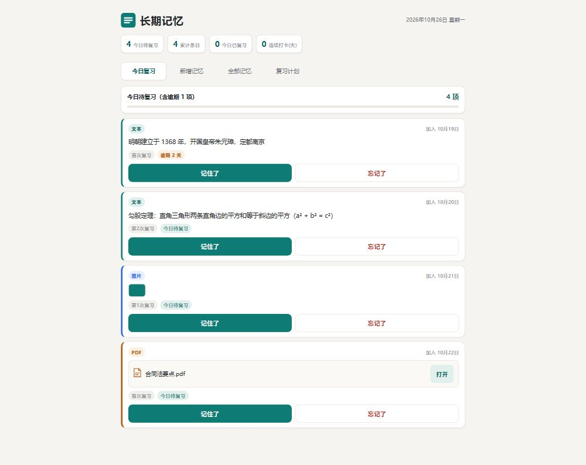
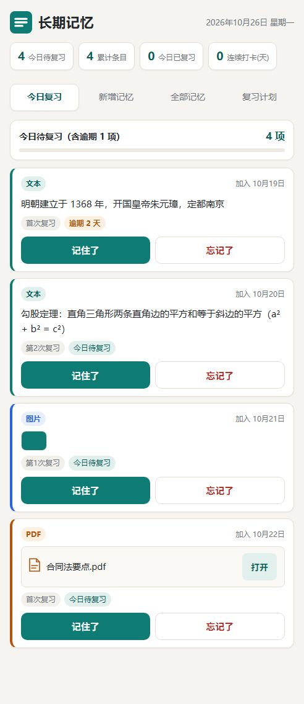
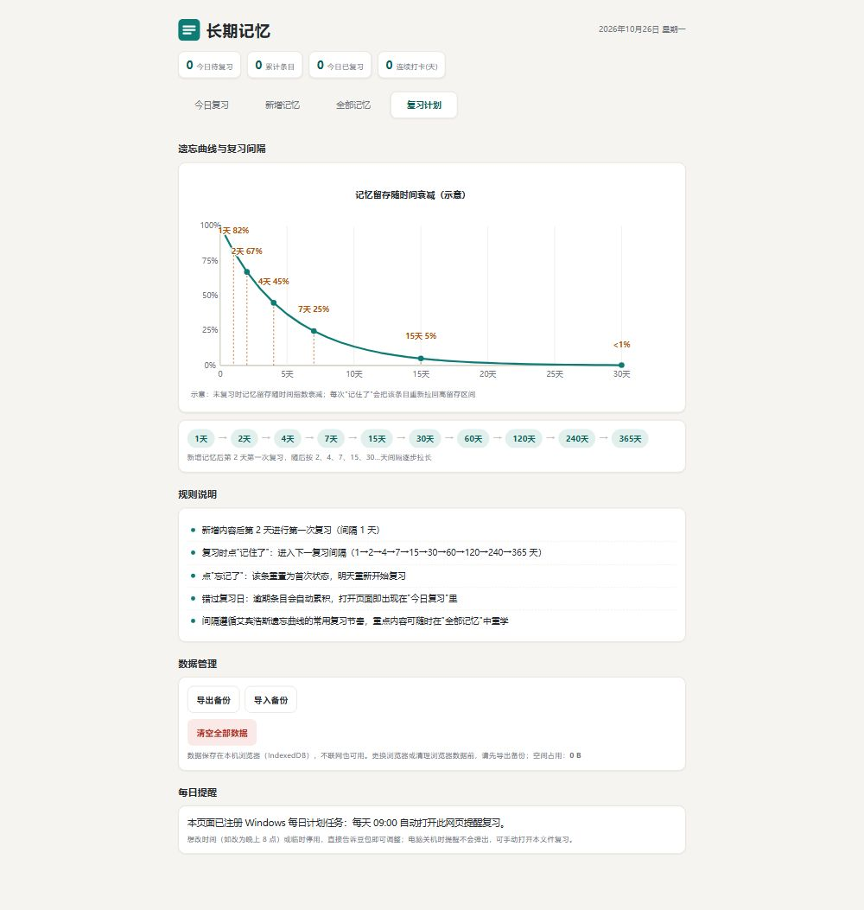
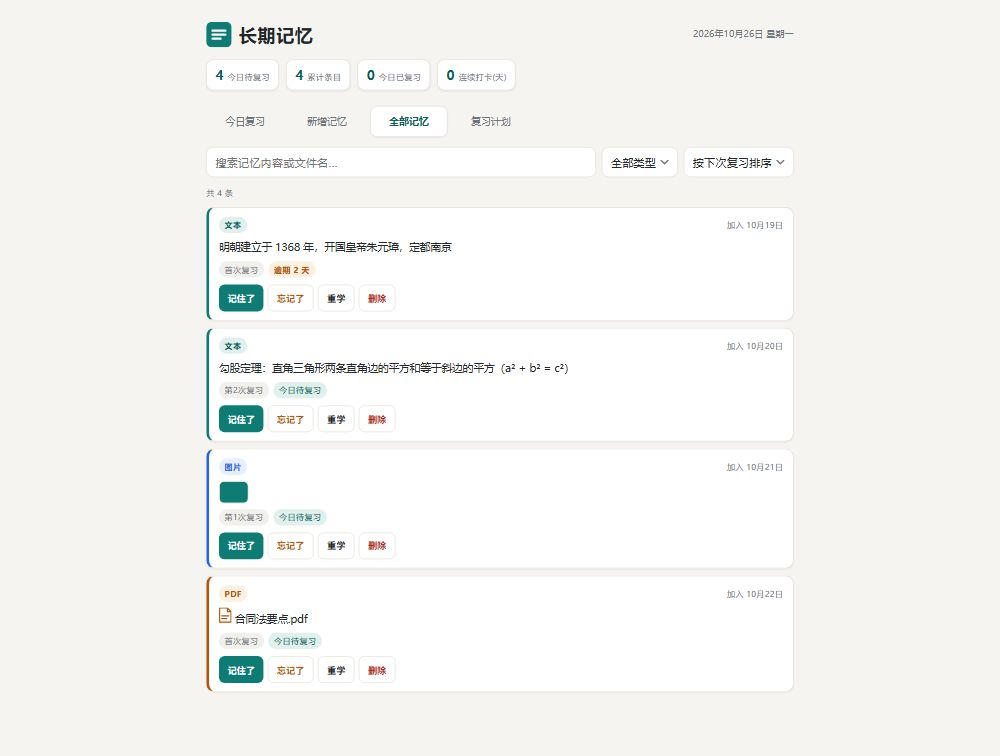

# Ebbinghaus Memory Review · 长期记忆复习

基于[艾宾浩斯遗忘曲线](https://zh.wikipedia.org/wiki/遗忘曲线)的本地记忆复习工具。**单文件 HTML**，零依赖、无服务器、离线可用。

新增内容后按 **1 → 2 → 4 → 7 → 15 → 30 → 60 → 120 → 240 → 365 天** 的间隔自动安排复习；复习时点"记住了"进入下一间隔，点"忘记了"重置为明天，逾期条目自动累积到当日。

## 功能

- **今日复习**：每天列出到期条目（含逾期天数提示），一键"记住了 / 忘记了"
- **新增记忆**：文本（每行一条）/ 图片 / PDF，支持多选、拖拽上传
- **全部记忆**：搜索、按类型筛选、按下次复习时间排序、重学、删除
- **复习计划**：遗忘曲线示意、复习间隔说明、数据导出 / 导入备份、一键清空
- **每日提醒**：可注册 Windows 计划任务，每天自动用浏览器打开复习页面
- **数据本地存储**：内容存于浏览器 IndexedDB，不联网、不经过任何服务器

## 截图

桌面端 · 今日复习



移动端 · 今日复习



复习计划（遗忘曲线与间隔说明）



全部记忆管理



## 使用方法

1. 下载 `长期记忆复习.html`，用 **Edge / Chrome** 双击打开即可使用
2. 在"新增记忆"里添加文本、图片或 PDF
3. 每天打开页面完成"今日复习"即可

### 数据说明（重要）

- 记忆数据保存在**打开页面的那台电脑的浏览器**里（IndexedDB），不会上传到 GitHub 或任何服务器
- 换电脑 / 换浏览器时：旧设备在"复习计划 → 导出备份"生成 JSON → 新设备"导入备份"即可迁移
- **备份 JSON 包含你的真实记忆内容，不要公开分享**

### Windows 每日提醒（可选）

默认每天 09:00 自动打开复习页面。注册提醒：

```powershell
$tr = 'powershell.exe -NoProfile -WindowStyle Hidden -ExecutionPolicy Bypass -File "打开记忆复习.ps1"'
schtasks /Create /TN "LongTermMemoryReview" /TR "`"$tr`"" /SC DAILY /ST 09:00 /F
```

修改时间把 `/ST 09:00` 换成其他时间（如 `20:00`）即可；删除提醒用 `schtasks /Delete /TN "LongTermMemoryReview" /F`。

## 技术细节

- 纯原生 JavaScript + IndexedDB，无框架、无构建、无外部 CDN
- 单文件自包含：样式、逻辑、数据读写全部内置于 `长期记忆复习.html`
- 图片 / PDF 以 Blob 形式存入 IndexedDB，文本直接存储

## License

[MIT](LICENSE)
